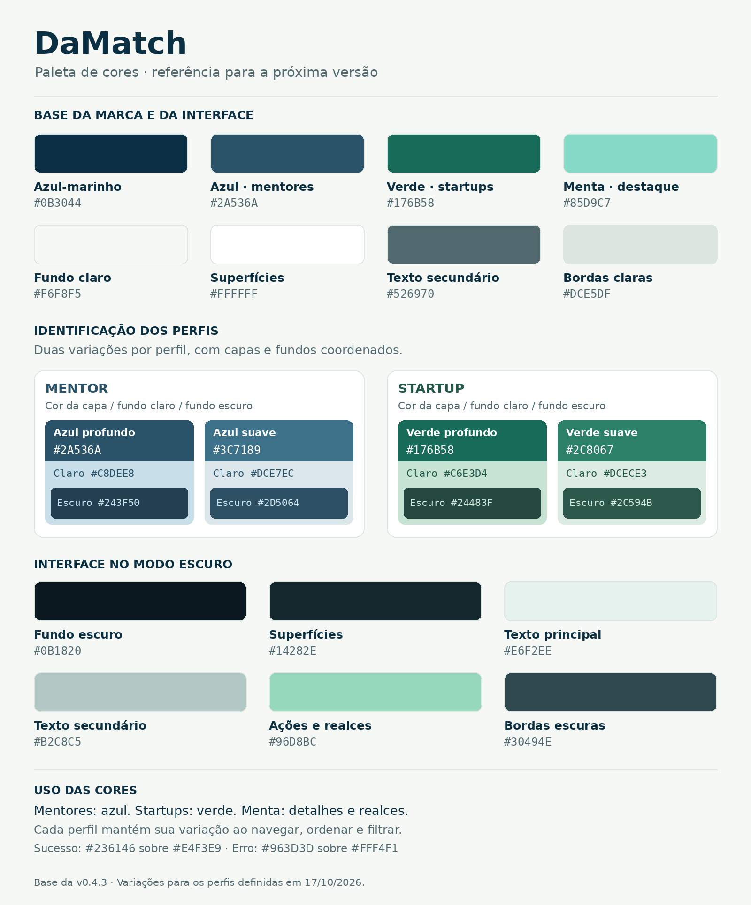

# 19 — Identidade visual do frontend

Referência da v0.5.0, consolidada em 17/10/2026.

## Base

| Uso | Cor |
| --- | --- |
| Marca, navegação e títulos no claro | `#0B3044` |
| Verde principal e ações no claro | `#176B58` |
| Menta de destaque | `#85D9C7` |
| Fundo claro | `#F6F8F5` |
| Superfícies claras | `#FFFFFF` |
| Texto secundário claro | `#526970` |
| Bordas claras | `#DCE5DF` |
| Fundo escuro | `#0B1820` |
| Superfícies escuras | `#14282E` |
| Texto principal escuro | `#E6F2EE` |
| Texto secundário escuro | `#B2C8C5` |
| Ações no escuro | `#96D8BC` |
| Bordas escuras | `#30494E` |

## Perfis

| Variação | Capa | Fundo claro | Fundo escuro |
| --- | --- | --- | --- |
| Mentor profundo | `#2A536A` | `#C8DEE8` | `#243F50` |
| Mentor suave | `#3C7189` | `#DCE7EC` | `#2D5064` |
| Startup profundo | `#176B58` | `#C6E3D4` | `#24483F` |
| Startup suave | `#2C8067` | `#DCECE3` | `#2C594B` |

As capas usam texto branco. Textos sobre os fundos suaves: mentor `#2A536A` no claro e `#CBE5F3` no escuro; startup `#235849` no claro e `#D2ECDF` no escuro.

A variação é derivada do identificador do perfil, mantendo a mesma cor ao ordenar e filtrar. As cores indicam o papel, sem representar pontuação, qualidade ou posição em um ranking. O rótulo Mentor/Startup permanece visível.

O corpo do card mantém a superfície do tema. Capas, avatares e etiquetas recebem a cor correspondente. Prévia e Meu perfil seguem a família do papel. Cores funcionais de sucesso e erro continuam específicas dos estados.

## Poses do Lumen

Os arquivos ficam em `frontend/public/assets/lumen/`.

| Arquivo | Uso |
| --- | --- |
| `welcome.png` | Boas-vindas na home; versão revisada |
| `curious.png` | Pergunta inicial e encontro |
| `thinking.png` | Setor e agenda |
| `presenting.png` | Necessidades e especialidades |
| `confirmed.png` | Confirmação breve de uma resposta |
| `complete.png` | Revisão e conclusão |

Os seis arquivos preservam o mesmo personagem, a paleta escura e o fundo transparente. A arte é inserida com proporção quadrada e espaço reservado para evitar deslocamento da interface.

As imagens não contêm os textos dos balões. Perguntas e mensagens são HTML, com semântica, foco e leitura próprios. O CSS controla flutuação, halo, entrada da pose e respeito às preferências de movimento.

